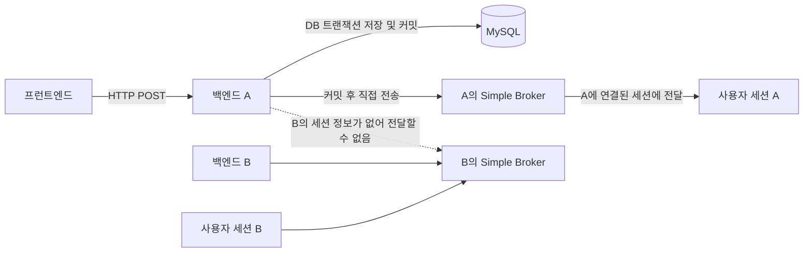

# 채팅 실시간 이벤트 현재 기준선

작성 기준일: 2026-10-23

이 문서는 서버 간 실시간 이벤트 전달을 구현하기 전의 AUDIGO 채팅 구조를 기록한다. 현재 동작과 변경 시 유지해야 할 조건을 설명하며, Redis Pub/Sub 구현 설계나 코드는 포함하지 않는다.

## 현재 구조 요약

- 채팅 메시지 전송은 HTTP API를 사용한다.
- WebSocket/STOMP 연결 경로는 `/ws/chat`이다.
- 각 백엔드 인스턴스는 메모리 기반 Spring Simple Broker를 사용한다.
- 클라이언트는 `/user/queue/chat/messages`를 구독한다.
- 메시지와 읽음 상태는 DB에 저장된 뒤 현재 인스턴스의 Simple Broker에 직접 전달된다.
- 온라인 상태는 기존 Redis 저장소에 공유되지만, 접속 상태 이벤트 자체는 현재 인스턴스의 Simple Broker에 직접 전달된다.
- 서버 A의 Simple Broker는 서버 B의 WebSocket 세션을 알지 못한다. 따라서 수신자가 B에만 연결되어 있는 경우 A에서 직접 보낸 이벤트는 B까지 전달되지 않는다.

## 현재 메시지 흐름



메시지 전송 API는 `POST /api/v2/chat/rooms/{roomId}/messages`다. `ChatMessageService`는 채팅방 상태와 멤버십, 멱등 키, 발신 사용자 활성 여부, 전송 제한을 확인한 뒤 채팅방 시퀀스와 메시지를 DB 트랜잭션 안에서 저장한다.

새 메시지 저장이 끝나면 트랜잭션 커밋 콜백에서 `ChatMessageRealtimeEvent`를 만들고 `SimpMessagingTemplate.convertAndSendToUser(...)`로 상대 사용자에게 보낸다. payload는 기존 프런트엔드 형식을 따른다.

```json
{
  "event_type": "MESSAGE_CREATED",
  "data": {
    "message_id": 901,
    "room_id": 15,
    "sender_id": 8,
    "client_message_id": "클라이언트 멱등 키",
    "message_seq": 21,
    "content": "안녕하세요",
    "sent_at": "2026-10-23T02:00:00Z"
  }
}
```

같은 발신자·채팅방·클라이언트 메시지 ID로 재요청하면 기존 메시지를 반환한다. 내용이 다르면 멱등 키 충돌로 거부한다. 기존 메시지를 재사용한 요청은 새 메시지 이벤트를 만들지 않는다. 새 메시지로 인해 상대에게 미읽음 메시지가 처음 생긴 경우 커밋 콜백에서 알림도 생성한다.

## 현재 읽음 상태 흐름

읽음 API는 `PATCH /api/v2/chat/rooms/{roomId}/read`다. `ChatMessageReadService`는 요청자의 채팅방 멤버십과 읽음 기준 메시지를 확인하고, 기준 시퀀스까지의 미읽음 상태를 DB에 기록한다.

방이 활성 상태이고 읽음 시간이 있으며 활성 상대가 정확히 한 명이면, 트랜잭션 커밋 후 `READ_RECEIPT_UPDATED` 이벤트를 그 상대에게 보낸다.

```json
{
  "event_type": "READ_RECEIPT_UPDATED",
  "room_id": 15,
  "reader_id": 42,
  "read_through_message_seq": 21,
  "read_at": "2026-10-23T02:00:00Z"
}
```

현재 전달은 메시지와 마찬가지로 해당 API 요청을 처리한 인스턴스의 Simple Broker까지만 간다.

## 현재 접속 상태 흐름

`ChatWebSocketPresenceListener`가 STOMP 세션 연결과 해제를 감지한다. `ChatPresenceConnectionManager`는 세션을 관리하고, `ChatPresenceRegistry`에서 해당 인스턴스 안의 사용자 세션 수를 추적한다. 상태 변화가 감지되면 `ChatPresenceNotificationService`가 활성 매칭 상대들을 조회해 각 상대에게 `PRESENCE_UPDATED`를 보낸다.

```json
{
  "event_type": "PRESENCE_UPDATED",
  "user_id": 42,
  "is_online": true
}
```

온라인 상태 공유 저장소와 이벤트 전달은 별개다.

- `RedisChatPresenceStore`는 사용자별 `chat:presence:user:<사용자 ID>` Redis 키에 세션을 기록한다.
- Redis 정렬 집합(sorted set)의 구성원은 인스턴스 ID와 STOMP 세션 ID를 조합한다.
- 접속 세션은 15초 간격으로 갱신되고, 세션 임대 시간은 45초, 키 TTL은 90초다.
- 이 Redis 저장소는 온라인 여부 조회에 사용되며, 채팅 이벤트를 저장하거나 전달하지 않는다.
- `PRESENCE_UPDATED` 알림은 현재 `SimpMessagingTemplate`을 통해 로컬 세션에만 전달된다.

### 여러 인스턴스에서 확인할 기존 동작

`ChatPresenceRegistry`의 세션 수는 인스턴스별 메모리에 있다. 같은 사용자가 서버 A와 B에 각각 처음 연결되면 두 인스턴스 모두 로컬 기준으로 온라인 전환을 감지할 수 있다. 반면 연결 해제 시에는 Redis에 다른 서버의 세션이 남아 있는지 확인한 뒤 전역 오프라인 알림을 보낸다. 접속 이벤트를 서버 간 전달로 확장할 때 온라인 전환의 중복 가능성을 고려해야 한다. 이 기준선에서는 기존 동작을 수정하지 않는다.

## WebSocket 인증과 구독 정책

`ChatWebSocketConfig`는 다음 목적지 설정을 사용한다.

| 설정 | 현재 값 |
|---|---|
| WebSocket 연결 | `/ws/chat` |
| Simple Broker | `/queue` |
| 애플리케이션 목적지 접두사 | `/app` |
| 사용자 목적지 접두사 | `/user` |
| 클라이언트 구독 | `/user/queue/chat/messages` |

`ChatStompAuthorizationInterceptor`는 인증된 연결만 허용하고 지정된 채팅 큐 외의 구독을 거부한다. 클라이언트의 STOMP `SEND`는 계속 거부한다. 채팅 메시지 전송 API와 HTTP 인증 정책은 이 기준선에 포함되며 유지해야 한다.

## 메시지 유실 시 현재 복구 흐름

메시지는 DB에 저장되므로 실시간 이벤트를 못 받아도 다시 조회할 수 있다. Catch-up API는 다음과 같다.

```text
GET /api/v2/chat/rooms/{roomId}/messages?after_message_seq=<마지막 시퀀스>&size=<페이지 크기>
```

응답은 이후 메시지 목록, `next_after_message_seq`, `has_next`를 포함한다. 요청자는 해당 채팅방의 구성원이어야 한다.

프런트엔드의 `connectChatRealtime`은 STOMP가 연결되면 `/user/queue/chat/messages`를 구독하고 연결 완료 콜백을 실행한다. `ChatRoomMessagingPage`는 그 콜백에서 catch-up과 방 상세 조회를 호출한다.

- Catch-up은 마지막 시퀀스 이후의 메시지를 가져와 화면에 합친다.
- 새 메시지 이벤트의 시퀀스가 현재 커서보다 앞서면 프런트엔드가 catch-up을 호출한다.
- Catch-up 요청이 실패하면 프런트엔드가 5초 후 다시 시도한다.
- 방 상세 조회는 화면에 표시 중인 메시지의 읽음 상태와 상대의 현재 접속 상태를 다시 맞춘다.
- STOMP 클라이언트는 연결이 끊어지면 3초 지연 후 재연결을 시도한다.

Catch-up API는 메시지 목록 복구용이다. 읽음 이벤트 이력과 접속 이벤트 이력을 재생하지 않으며, 해당 상태는 방 상세 조회로 최신 값을 다시 확인한다.

## 이후 변경 시 유지할 조건

1. 메시지 전송은 기존 HTTP API로 유지한다.
2. DB 저장 구조와 멱등 처리, 기존 알림 생성 조건을 유지한다.
3. 메시지와 읽음 상태 이벤트는 DB 커밋 뒤 발행한다.
4. 기존 이벤트의 `event_type`과 payload JSON 구조를 유지한다.
5. 연결 경로, 프런트엔드 구독 경로, 인증과 STOMP `SEND` 거부 정책을 유지한다.
6. 온라인 상태 Redis 키와 채팅 이벤트 Pub/Sub 채널을 다른 용도로 취급한다.
7. 이벤트 전달이 실패해도 저장된 DB 데이터를 되돌리지 않는다.
8. 외부 STOMP 브로커 도입은 현재 기준선에 포함하지 않는다.

## 현재 구현 범위 확인

이 문서는 기존 구조만 기록한다. 서버 간 채팅 이벤트용 Redis Pub/Sub 채널, 발행자, 수신기, 로컬 전달 컴포넌트는 아직 구현되어 있지 않다.
